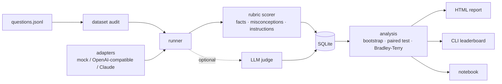

# bio-llm-eval

[](https://github.com/ryantravonmcdowell/LLM_Eval/actions/workflows/ci.yml)


**Rubric-based evaluation of large language model answers to biology questions.**

`bio-llm-eval` grades model answers the way a careful human reviewer would: does the answer
state the facts a correct answer needs, does it assert a known misconception, does it show its
reasoning, and does it follow the instructions it was given? Every lost point is labelled with an
error type, mean scores come with confidence intervals and significance tests, and the question
set is tested like code before any model is graded against it.

## What it does

- **A biology question set:** 30 questions across 9 subjects, from molecular biology to
  ecology. Each has a reference answer, weighted key facts, reasoning steps, known
  misconceptions and formatting constraints.
- **Dataset audit:** every reference answer must pass its own rubric, and every misconception
  must be caught by its own patterns. Broken rubrics fail CI instead of silently mis-grading.
- **Automatic grading** with an error taxonomy: `factual_error`, `missing_key_fact`,
  `reasoning_gap`, `instruction_violation`, `refusal_or_empty`.
- **Model adapters** behind one interface: any OpenAI-compatible server (including self-hosted
  vLLM or Ollama), Claude through the official `anthropic` SDK, and a deterministic offline mock
  for demos and tests.
- **Optional LLM-as-judge** grading, reported side by side with the rubric and their rank
  agreement, so neither grader is taken on trust.
- **Statistics you can defend:** bootstrap confidence intervals, a paired bootstrap test between
  models, and Bradley-Terry ratings from head-to-head comparisons.
- **Reproducible storage:** runs, responses, scores and error labels in SQLite, resumable after
  a crash, with reports rebuilt from the database alone.
- **Outputs:** a self-contained HTML report, a CLI leaderboard, Markdown tables and an
  [error-analysis notebook](notebooks/error_analysis.ipynb).

## Quick start

```bash
git clone https://github.com/ryantravonmcdowell/LLM_Eval.git
cd LLM_Eval
python -m venv .venv
source .venv/bin/activate          # Windows: .venv\Scripts\activate
pip install -e ".[dev]"

bioeval validate                   # audit the bundled question set
bioeval demo                       # offline end-to-end run, no API key needed
```

`bioeval demo` grades three **simulated** models that degrade the reference answers in known
ways (dropped sentences, injected misconceptions, broken formatting, refusals). It writes
`demo_output/report.html` and a leaderboard (abridged here):

| model | mean score | 95% CI | fact coverage | misconception rate | instruction pass | refusal rate | rating |
|---|---|---|---|---|---|---|---|
| mock-strong | 0.993 | 0.978 – 1.000 | 0.993 | 0.000 | 1.000 | 0.000 | 1160.9 |
| mock-medium | 0.765 | 0.641 – 0.879 | 0.844 | 0.133 | 0.800 | 0.067 | 1000.0 |
| mock-weak | 0.505 | 0.387 – 0.620 | 0.631 | 0.333 | 0.767 | 0.100 | 839.1 |

`bioeval leaderboard --db demo_output/results.db` adds the significance test:

```
Paired bootstrap (top model vs others):
                comparison  questions  mean_diff  ci_low  ci_high  p_value significant
mock-strong vs mock-medium         30      0.227   0.113    0.351 < 0.0002         yes
  mock-strong vs mock-weak         30      0.488   0.374    0.601 < 0.0002         yes
```

These numbers describe the simulator, not any real model. They show that the pipeline ranks
models whose quality is known in advance in the right order, with intervals that separate them.

## Evaluating real models

```bash
pip install -e ".[anthropic]"            # only needed for Claude models
export ANTHROPIC_API_KEY=...              # or: ant auth login
export OPENAI_API_KEY=...

bioeval run --model anthropic:claude-opus-5-5 \
            --model openai:<model-name> \
            --judge anthropic:claude-opus-5-5
bioeval report --out report.html
bioeval leaderboard
```

| Spec | Backend |
|---|---|
| `mock:strong`, `mock:medium`, `mock:weak` | deterministic offline simulator |
| `openai:<model>` | any OpenAI-compatible `/chat/completions` server; set `OPENAI_BASE_URL` for a self-hosted one |
| `anthropic:<model>[@effort]` | Claude via the `anthropic` SDK, e.g. `anthropic:claude-opus-5-5@low` |

A few behaviours are deliberate:

- **Misconfiguration stops the run; flaky calls do not.** A bad key or unknown model aborts
  that model's run at once, while a call that still fails after retries is recorded as an
  `adapter_error` and the run continues.
  `bioeval run --resume <run_id>` picks up where an interrupted run stopped.
- **No silent model substitution.** The Claude adapter does not enable server-side fallback to
  another model: a declined question is recorded as a refusal and graded as one, because a
  fallback would grade one model's answer under another model's name.
- **Choose the judge with care.** Models tend to favour their own answers, so prefer a judge
  that is not one of the models under test, and read the rubric-vs-judge agreement in the report.

## How grading works

Each question carries its own rubric (see [docs/writing_questions.md](docs/writing_questions.md)
for the format and a review checklist):

```text
score = coverage × (0.75 + 0.25 × compliance) × (1 − penalty)

coverage    weighted share of key facts and reasoning steps present in the answer
compliance  1.0 if length/format instructions are met, minus 0.5 per violation
penalty     0.5 per misconception asserted (capped at 1)
```

Content comes first. A well-formatted answer with nothing correct in it scores zero. An answer
that is complete but asserts a known misconception loses half its score, so a confident wrong
answer cannot beat a shorter correct one. Refusals and empty answers score zero. Weights are
configurable through `RubricWeights`.

| Error label | Meaning |
|---|---|
| `factual_error` | Asserts a known misconception or incorrect claim. |
| `missing_key_fact` | Leaves out a fact a correct answer must contain. |
| `reasoning_gap` | Skips an intermediate step needed to justify the answer. |
| `instruction_violation` | Ignores a length or format instruction in the prompt. |
| `refusal_or_empty` | Declines to answer or returns nothing. |
| `adapter_error` | The model API call failed; no answer was graded. |

Answers and references are normalised before matching (`5′→3′` becomes `5' to 3'`, `q²`
becomes `q^2`, curly quotes and dashes become plain ones), so the patterns stay short and
readable.

## Statistics

- **Bootstrap confidence intervals** on every mean score, resampling questions.
- **Paired bootstrap** between models: both answered the same questions, so the test resamples
  questions and compares the two models on each one. A p-value finer than the resampling can
  resolve is reported as a bound (`< 0.0002`), never as zero.
- **Bradley-Terry ratings** (MM algorithm) from per-question head-to-head outcomes, with ties
  counted as half a win, on an Elo-like scale.
- **Spearman rank agreement** between the rubric and the LLM judge, computed without SciPy.

## Architecture



Model calls run in a thread pool. Grading and database writes stay on one thread, and each
result is committed as it arrives.

```text
src/bioeval/
├── data/biology_v1.jsonl   question set (30 questions, 129 key facts, 30 misconceptions)
├── schema.py               typed question / rubric records and validation
├── dataset.py              loading and the self-consistency audit
├── textnorm.py             normalisation shared by the audit and the scorers
├── scoring/                fact coverage, misconceptions, instruction checks, taxonomy
├── adapters/               mock, OpenAI-compatible (urllib), Claude (anthropic SDK)
├── judge.py                LLM-as-judge prompt and strict verdict parsing
├── runner.py               concurrent, resumable evaluation runs
├── storage.py              SQLite schema, SQL breakdowns
├── stats.py, ranking.py    bootstrap tests, Bradley-Terry
├── analysis.py, report.py  leaderboard tables and the HTML report
└── cli.py                  `bioeval` command
```

## Development

```bash
pytest                  # 108 tests: dataset, scoring, adapters (local HTTP server), runner, stats, report
ruff check src tests
```

CI runs lint, tests, the dataset audit and the demo on Python 3.10–3.13, and builds and runs
the Docker image.

```bash
docker build -t bioeval .
docker run --rm bioeval                                   # runs the demo
mkdir -p out && docker run --rm -v "$PWD/out:/work/out" bioeval demo --out-dir out
```

## Limitations

- **The pattern rubric is literal.** A correct answer phrased in an unexpected way can miss a key
  fact. The LLM judge and the agreement table exist to catch this. The lasting fix is to add
  the phrasing to the rubric.
- **30 questions give wide intervals.** The gap between two strong real models is often not
  significant at this size; the paired test says so explicitly rather than crowning a winner.
- **The demo models are simulations.** They verify the pipeline, not any real model's biology
  knowledge.

## License

MIT, see [LICENSE](LICENSE).
